# Nature Zen

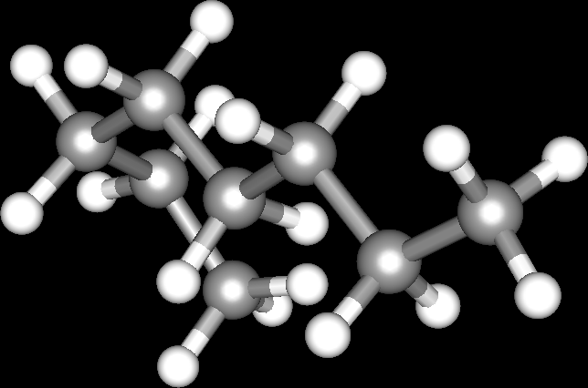

Main branches:

Topic branches, ordered alphabetically:

## Goal

Collaboratively create a game, to be put on Steam.

* [architecture](doc/architecture.md)
* [code of conduct](code_of_conduct.md)
* [coding standard](doc/coding_standard.md)
* [FAQ](doc/faq.md)
* [game](doc/game.md)
* [git](doc/git.md)
* [install](doc/install.md)
* [new members](doc/new_members.md)
* [new members procedure](doc/new_members_procedure.md)
* [planning](doc/planning.md)
* [social](doc/social.md)
* [suggest and vote](doc/ideas.md)
* [team](doc/team.md)
* [technical specs](doc/specs.md)
* [todo](doc/todo.md)
* [videos](doc/videos.md)

## Progress

Most recent at the top. See [videos](doc/videos.md) for the [videos](doc/videos.md).

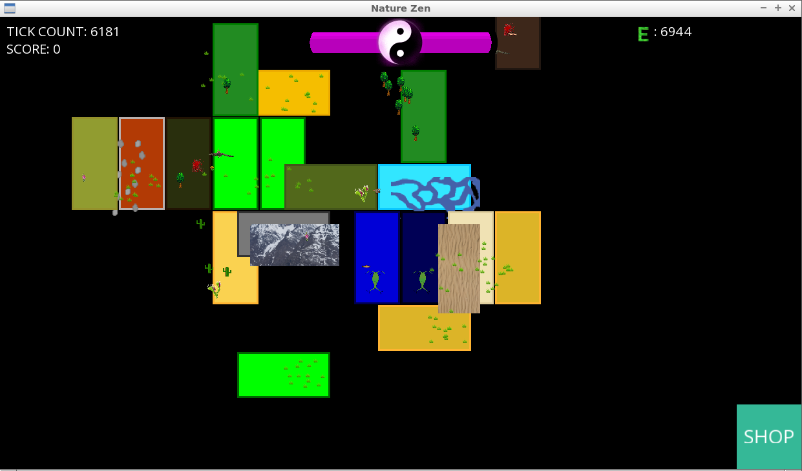

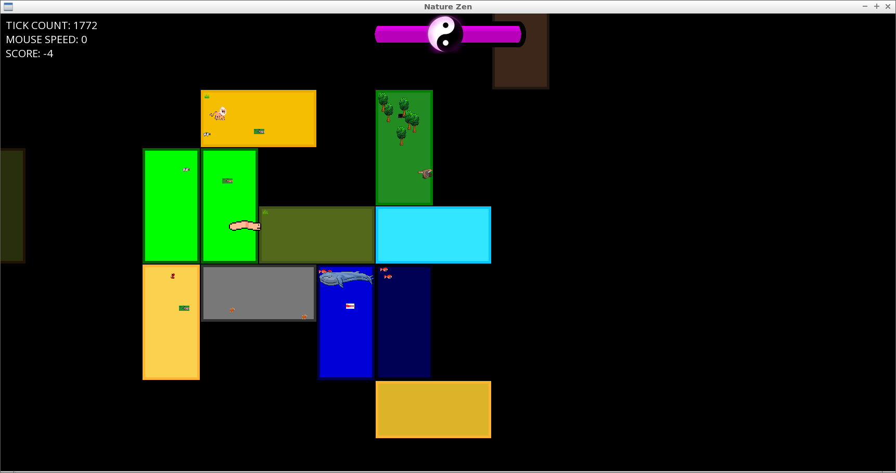

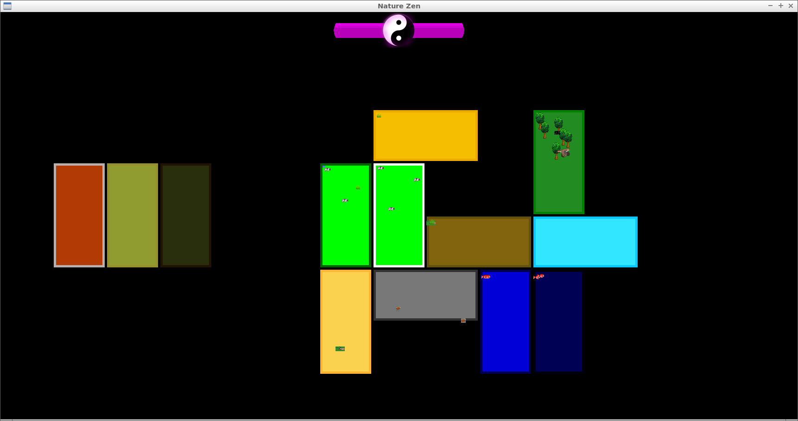

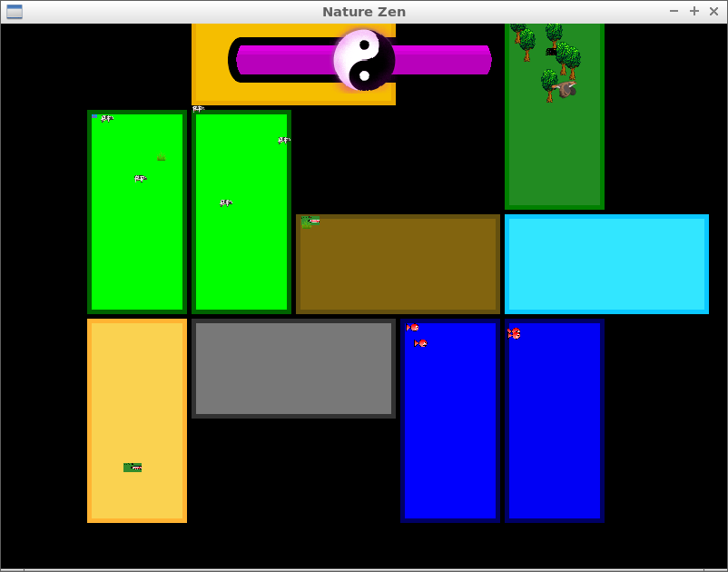

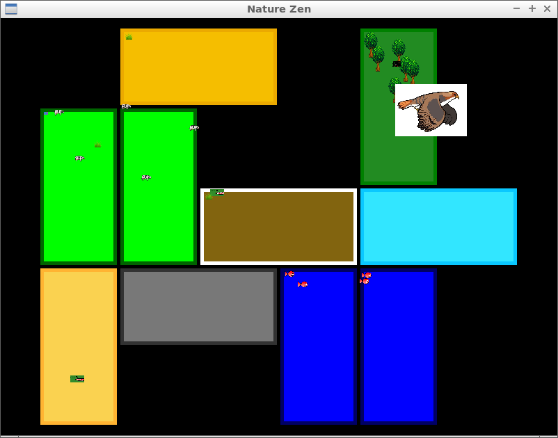

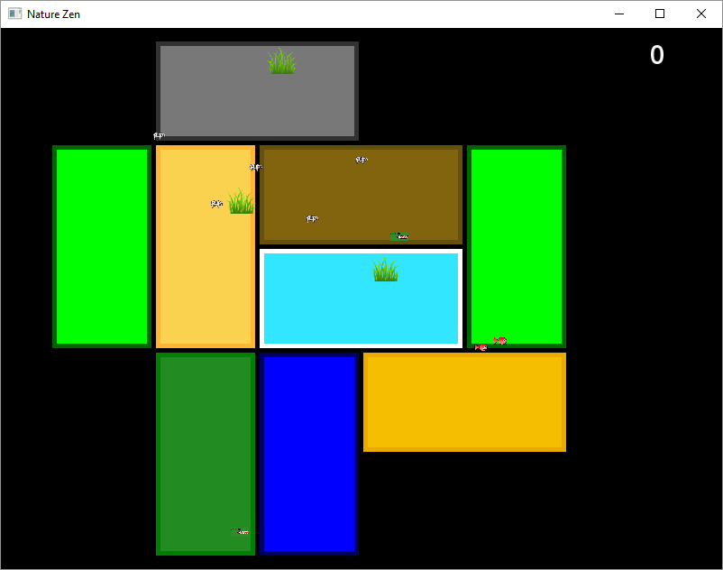

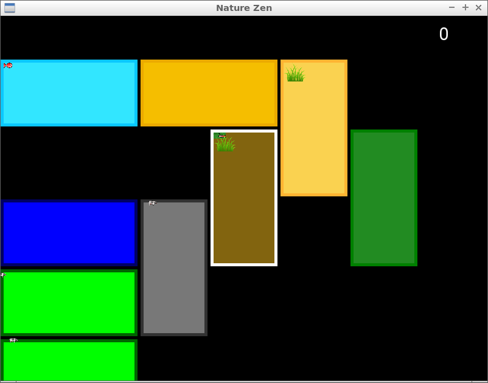

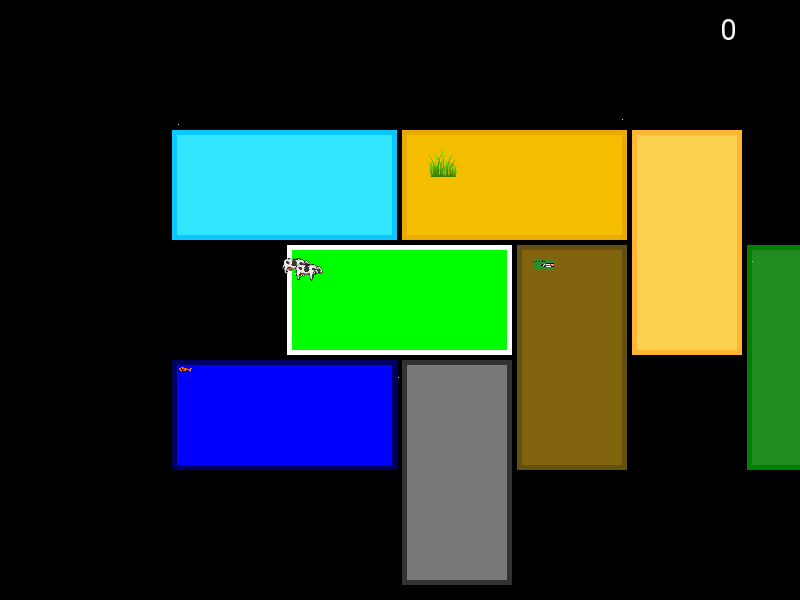

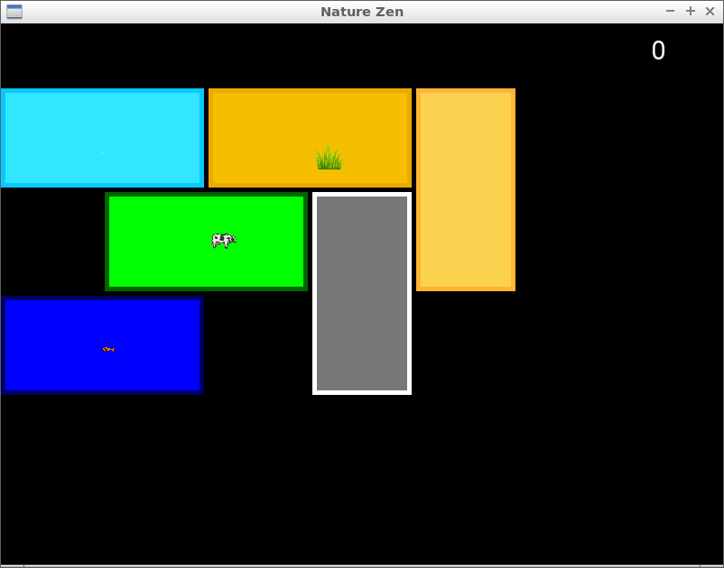

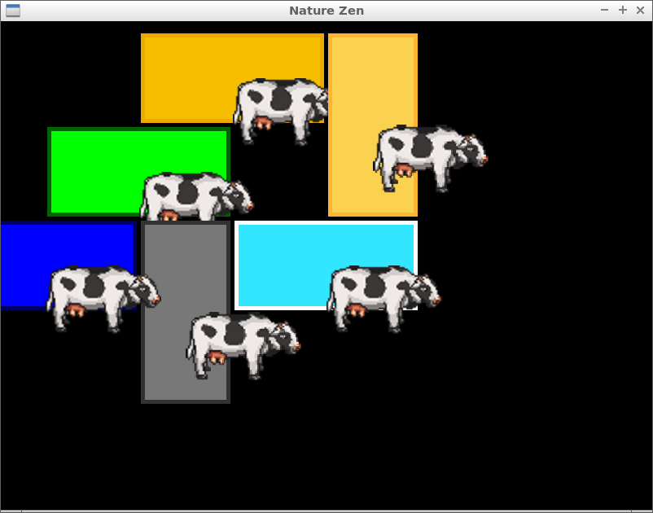

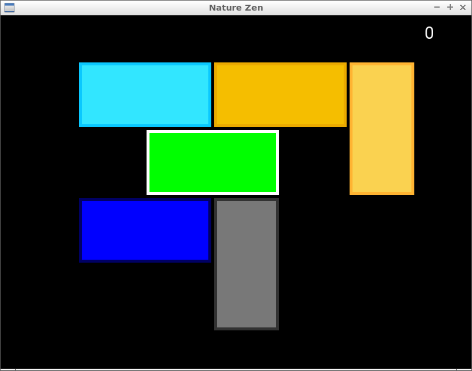

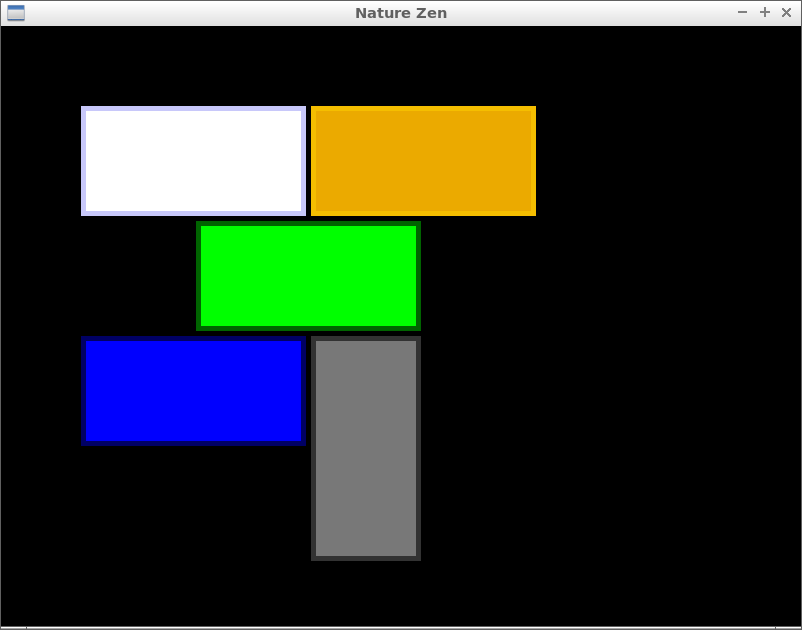

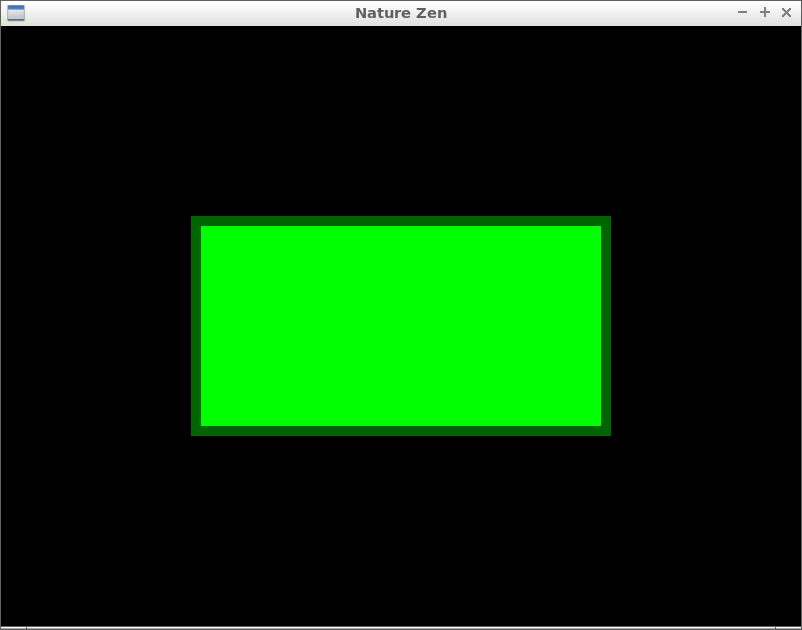

